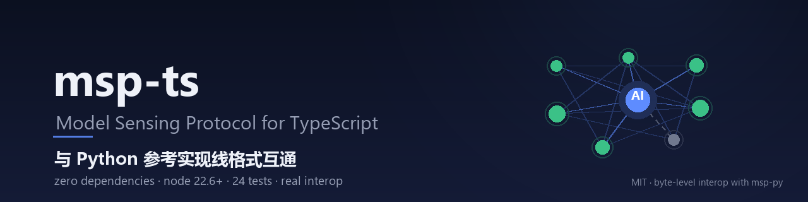

# msp-ts

<p align="center">
  
</p>

<p align="center">
  <a href="https://github.com/ModelSensingProtocol/msp-ts/stargazers"></a>
  <a href="LICENSE"></a>
  <a href="https://github.com/ModelSensingProtocol/msp-ts/commits/master"></a>
  
  
  
  <br>
  
  <a href="https://pypi.org/project/msp-py/"></a>
  
</p>

MSP（Model Sensing Protocol）的 **TypeScript 实现**，与 Python 参考实现（`msp-py`）**线格式互通**：
同一个共享目录里，TS 节点和 Python 节点互相发现、互相调用工具、互相订阅广播。

当前是 **M1 + M2**（线格式 + 节点层），能跑真实互通；模式层与 MCP 桥还没做。

## 零依赖，直接跑

```bash
npm test          # 24 个用例，其中 10 个是与真 Python 进程的互通
```

不需要 `npm install`、不需要构建：Node ≥ 22.6 原生剥离类型，`src/*.ts` 直接被执行。
（`npm i` 只为 `npm run typecheck` / `npm run build` 与将来发布。）

### 两种测试的依赖不同

| 命令 | 用例 | 需要什么 |
|---|---|---|
| `npm run test:unit` | 14 | **什么都不需要**，零依赖 |
| `npm run test:interop` | 10 | 一个能跑的 `msp` Python 包 |

互通测试要真的起 Python 节点进程，所以它得找到 `msp`。三选一：

```bash
# 1) 指向 msp-py 的源码树
MSP_PY_SRC=/path/to/MSP/src npm run test:interop

# 2) 把参考实现克隆到本仓库的同级目录（默认就找这个名字）
git clone https://github.com/hxh230802/MSP ModelSensingProtocol

# 3) 直接装包（PyPI 上是预发布，要 --pre）
pip install --pre msp-py
```

## 结构

按层分目录，与 `msp-py`（`msp/{core,protocol,transport,discovery,presence}`）
和 `msp-dotnet`（`src/Msp/{Core,Protocol,Transport,Discovery,Presence}`）对齐：

```
src/
├─ index.ts                 公开出口（只导出这里列的名字）
├─ core/
│  ├─ signal.ts             SignalType / Signal / make / encode / decode
│  ├─ manifest.ts           ToolSpec + Manifest
│  ├─ content.ts            ToolResult（错误即值）
│  └─ grammar.ts            名字文法（node id / tool name / signal path）
├─ protocol/
│  ├─ framing.ts            4 字节大端长度前缀的流式分帧
│  ├─ matcher.ts            `*` / `**` 通配符匹配
│  └─ protocol.ts           握手 / 去重仲裁 / 分发 / reqid / 广播 / 探活
├─ transport/
│  ├─ base.ts               ConnectionLike / TransportLike / Endpoint 契约
│  └─ tcp.ts                TcpConnection / TcpTransport
├─ discovery/
│  ├─ base.ts               DiscoveredEndpoint / Discovery 契约
│  └─ directory.ts          共享目录轮询扫描
├─ presence/
│  └─ directory.ts          共享目录宣告 + 租约续期
└─ node.ts                  组装点（在这里才 new 传输层并注入协议层）
test/
├─ unit/{signal,framing,matcher,manifest}.test.ts
├─ interop/{eager,lazy}.test.ts
└─ support/{harness.ts,py_node.py}
```

两条结构约束：

- **协议层不认识 TCP**：`Protocol` 只依赖注入的 `TransportLike`，所以将来加浏览器 WS
  传输不用改协议层，也能用假传输层单测协议。
- **公开面只有一个出口**：`src/index.ts`。内部目录怎么动，`import` 路径不变。

## 用法

```ts
import { MSPNode } from "msp-ts";

const node = new MSPNode("ts_b", { nodesDir: "/tmp/msp-nodes" });

node.tool("add", "加法", ({ a, b }) => Number(a) + Number(b), {
  type: "object",
  properties: { a: { type: "integer" }, b: { type: "integer" } },
  required: ["a", "b"],
});

node.on("notify.**", (sig) => console.log(sig.path, sig.payload));   // 通配符订阅
node.declareSignal("sensor.ts.temp");

await node.start();                                   // 监听 + 宣告 + 发现 + eager 拨号
const r = await node.call("py_a", "py_echo", { msg: "hi" });
console.log(r.unwrap());                              // { echo: "hi" }
node.publish("sensor.ts.temp", { celsius: 26.5 });    // 广播给所有已连对端
```

## 与 msp-py 的对应

| msp-py | msp-ts | 说明 |
|---|---|---|
| `core/signal.py` | `core/signal.ts` | 8 字段全量输出，None→`null`，未知键经 extras 回带 |
| `core/manifest.py` | `core/manifest.ts` | 9 个容器字段同形 |
| `core/content.py` | `core/content.ts` | `is_error` + `unwrap()` |
| `protocol/matcher.py` | `protocol/matcher.ts` | `system.**` 连 `system` 本身也匹配 |
| `transport/tcp.py` | `transport/tcp.ts` + `protocol/framing.ts` | 长度前缀分帧单独成文件 |
| `discovery/directory.py` | `discovery/directory.ts` | 同一份声明文件格式，租约 30s / 续租 5s |
| `presence/directory.py` | `presence/directory.ts` | tmp + rename 原子写 |
| `protocol/protocol.py` | `protocol/protocol.ts` | 去重仲裁：node_id 较小一方 outbound |

**有意不同的一处**：schema 不做签名自省。TS 的类型运行时不存在，`inputSchema` 显式传入
（正式版建议接 Zod/TypeBox，让 schema 成为唯一真相源，类型从它反推）。

## 互通测试测了什么

`test/interop/*.test.ts` 起真 Python 进程（`test/support/py_node.py`），两个场景：

| 场景 | 覆盖 |
|---|---|
| **eager**：`py_a` 用 FULL_PEER，规范方向是它拨 `ts_b` | TS 接受入站 → 握手 → 去重仲裁；TS 调 py；py 调 TS；双向广播；清单交换 |
| **lazy**：`zz_lazy` 用 LOCAL_TOOL（只宣告不发现），规范方向是 `aa_ts` 拨它 | TS 主动拨号 + 出站握手；TS 调 lazy 工具；**反向调用**；错误即值 |

## 发现的参考实现缺陷（已绕开，未修复）

**`on_connected` 回调在 ACK 之前触发。** `MSPProtocol._finish_handshake` 里先
`for cb in self._on_connected: cb(...)`，`handshake_inbound` 之后才 `conn.send(ACK)`。
回调里若 `call()`，线上顺序变成：

```
HELLO → tool_call →（回调阻塞等结果）→ ACK
```

对端在 `handshake_outbound` 里等 ACK，收到 `tool_call` 判「握手失败」→ 断开 → 双方死锁到超时。
**Python 对 Python 也一样中招**（只要任一节点在 `on_connected` 里发报文）。

两个处理：
1. 互通脚本改成「后台线程等连接进表」再动作（`test/support/py_node.py`）；
2. msp-ts 做**宽容握手**：等 ACK 期间收到非 ACK 帧就临时登记并立即处理，
   把对端从死锁里放出来（`protocol/protocol.ts` 的 `handshakeOutbound`）。

建议参考实现把 `conn.send(ACK)` 移到触发回调之前——这是协议顺序问题，不是用法问题。

## 还没做的

| 里程碑 | 内容 |
|---|---|
| M3 | `msp/multi-round`、`msp/task` 模式 |
| M4 | MCP 桥（吃官方 `@modelcontextprotocol/sdk`） |
| M5 | 浏览器 profile（WS-only + 手动发现；浏览器没有 TCP/目录发现） |

另外还没接：`grants` 授权表（局域网内先信任）、`settle()`（TS 里等连接天然是 await）。

## 相关

- [`msp-py`](https://github.com/hxh230802/MSP) — Python 参考实现（[PyPI: `msp-py`](https://pypi.org/project/msp-py/)，当前 `0.1.0a1`）
- `msp-dotnet` — .NET 实现
- 线格式、握手、租约、去重仲裁等协议细节以 Python 参考实现的 `docs/DESIGN.md` 为准，本实现只保证**字节级互通**。

## 已知限制

- 模式层（`multi-round` / `task`）与 MCP 桥未实现，当前只有 `request-reply` 与 `publish-subscribe`。
- 断开不自动重连（靠发现轮询重新接入）。
- 无 TLS、无鉴权：定位是本机 / 局域网。
